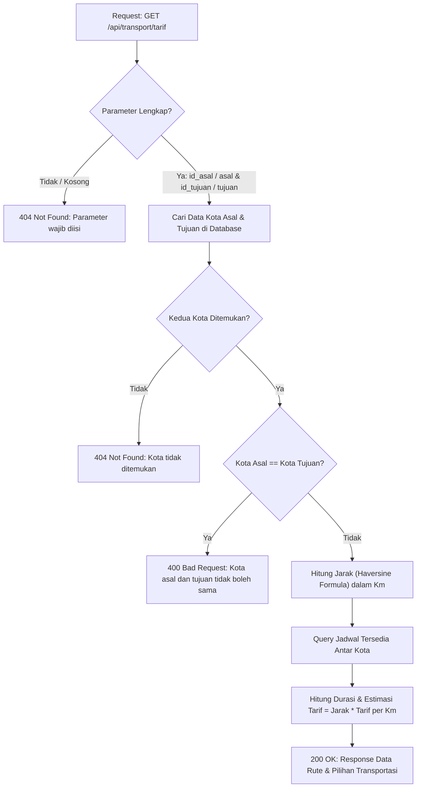

# Dokumentasi Spesifikasi REST API - Transport Application

Dokumentasi resmi untuk antarmuka pemrograman aplikasi (API) Transport Application berbasis CodeIgniter 4. Dokumentasi ini merinci seluruh endpoint yang tersedia, parameter yang diterima, format keluaran (response), kode status HTTP, serta contoh integrasi klien.

---

## 1. Informasi Umum

- **Base URL Pengembangan**: `http://localhost:8080`
- **Prefix Endpoint**: `/api/transport`
- **Format Pertukaran Data**: JSON (`application/json`)
- **Controller Terkait**: [`Transport.php`](file:///home/azure/client-server-project/transport-aplication/app/Controllers/Api/Transport.php)
- **Konfigurasi Rute**: [`Routes.php`](file:///home/azure/client-server-project/transport-aplication/app/Config/Routes.php)

### Standar Header HTTP
Klien disarankan untuk menyertakan header berikut pada setiap permintaan:
```http
Accept: application/json
```

---

## 2. Diagram Alur Endpoint Tarif

Endpoint `/api/transport/tarif` memproses pencarian rute, validasi, penghitungan jarak bola bumi (Haversine Formula), dan estimasi biaya berdasarkan data jadwal penyedia moda transportasi.



---

## 3. Daftar Rute API

| No | Method | Endpoint | Handler | Deskripsi |
| :--- | :--- | :--- | :--- | :--- |
| 1 | `GET` | `/api/transport/transports` | `Transport::index` | Mengambil seluruh master data moda transportasi |
| 2 | `GET` | `/api/transport/kota` | `Transport::kota` | Mengambil daftar seluruh kota terurut abjad (A-Z) |
| 3 | `GET` | `/api/transport/tarif` | `Transport::tarif` | Menghitung jarak antarkota dan rincian tarif perjalanan |
| 4 | `POST`/`GET` | `/api/transport/rekomendasi-wisata` | `Transport::rekomendasiWisata` | Rekomendasi rute & estimasi biaya (One-Way / Round-Trip) berdasarkan koordinat user & wisata |

---

## 4. Spesifikasi Endpoint

### 4.1. Ambil Semua Moda Transportasi

Mengambil seluruh jenis moda transportasi publik yang terdaftar (contoh: Pesawat, Kereta Api, Bus, Travel).

- **Method**: `GET`
- **Path**: `/api/transport/transports`
- **Autentikasi**: *None*
- **Parameter**: *None*

#### Response Sukses (200 OK)
```json
{
  "status": "success",
  "data": [
    {
      "id": "1",
      "jenis": "Pesawat",
      "created_at": "2026-11-14 10:00:00",
      "updated_at": "2026-11-14 10:00:00"
    },
    {
      "id": "2",
      "jenis": "Kereta Api",
      "created_at": "2026-11-14 10:00:00",
      "updated_at": "2026-11-14 10:00:00"
    },
    {
      "id": "3",
      "jenis": "Bus",
      "created_at": "2026-11-14 10:00:00",
      "updated_at": "2026-11-14 10:00:00"
    }
  ]
}
```

---

### 4.2. Ambil Daftar Kota

Mengambil seluruh kota yang tercatat dalam sistem beserta informasi titik koordinat bumi (`latitude` & `longitude`). Digunakan untuk mengisi opsi dropdown pemilihan rute asal dan rute tujuan pada aplikasi front-end/mobile.

- **Method**: `GET`
- **Path**: `/api/transport/kota`
- **Autentikasi**: *None*
- **Parameter**: *None*

#### Response Sukses (200 OK)
```json
{
  "status": "success",
  "data": [
    {
      "id": "1",
      "nama_kota": "Bandung",
      "latitude": "-6.91746400",
      "longitude": "107.61912300",
      "created_at": "2026-11-14 10:00:00",
      "updated_at": "2026-11-14 10:00:00"
    },
    {
      "id": "2",
      "nama_kota": "Jakarta",
      "latitude": "-6.20876340",
      "longitude": "106.84559900",
      "created_at": "2026-11-14 10:00:00",
      "updated_at": "2026-11-14 10:00:00"
    },
    {
      "id": "3",
      "nama_kota": "Surabaya",
      "latitude": "-7.25747190",
      "longitude": "112.75208830",
      "created_at": "2026-11-14 10:00:00",
      "updated_at": "2026-11-14 10:00:00"
    }
  ]
}
```

---

### 4.3. Hitung Jarak dan Rincian Tarif

Menghitung jarak lurus geografis antar dua titik koordinat kota asal dan tujuan menggunakan rumus Haversine, lalu mengkalkulasikan estimasi tarif berdasarkan jadwal dan tarif per kilometer masing-masing operator transportasi.

- **Method**: `GET`
- **Path**: `/api/transport/tarif`
- **Autentikasi**: *None*

#### Parameter Permintaan (Query String)
Klien dapat memilih salah satu dari dua metode pengiriman parameter:

##### Pilihan A: Menggunakan ID Kota (Direkomendasikan)
| Parameter | Tipe Data | Wajib | Keterangan |
| :--- | :--- | :--- | :--- |
| `id_asal` | Integer | Ya* | ID unik kota asal (mengacu pada data tabel `kota`) |
| `id_tujuan` | Integer | Ya* | ID unik kota tujuan (mengacu pada data tabel `kota`) |

##### Pilihan B: Menggunakan Nama Kota
| Parameter | Tipe Data | Wajib | Keterangan |
| :--- | :--- | :--- | :--- |
| `asal` | String | Ya* | Nama kota asal (pencarian fuzzy / `LIKE %nama%`) |
| `tujuan` | String | Ya* | Nama kota tujuan (pencarian fuzzy / `LIKE %nama%`) |

> [!NOTE]
> Harus menyertakan pasangan `id_asal` & `id_tujuan` ATAU pasangan `asal` & `tujuan`. Jika parameter ID diisi, sistem akan memprioritaskan pencarian berdasarkan ID.

#### Contoh Permintaan
```http
GET /api/transport/tarif?id_asal=2&id_tujuan=1 HTTP/1.1
Host: localhost:8080
Accept: application/json
```
atau
```http
GET /api/transport/tarif?asal=Jakarta&tujuan=Bandung HTTP/1.1
Host: localhost:8080
Accept: application/json
```

#### Response Sukses (200 OK)
```json
{
  "status": "success",
  "data": {
    "rute": {
      "asal": {
        "id": 2,
        "nama_kota": "Jakarta",
        "latitude": -6.2087634,
        "longitude": 106.845599
      },
      "tujuan": {
        "id": 1,
        "nama_kota": "Bandung",
        "latitude": -6.917464,
        "longitude": 107.619123
      },
      "jarak_km": 118.87
    },
    "total_jadwal_tersedia": 2,
    "pilihan_transportasi": [
      {
        "id_jadwal": 1,
        "penyedia": "PT Kereta Api Indonesia",
        "jenis_transport": "Kereta Api",
        "durasi": "2 Jam 45 Menit",
        "tarif_per_km": 1200,
        "estimasi_tarif": 142600,
        "estimasi_tarif_format": "Rp 142.600"
      },
      {
        "id_jadwal": 2,
        "penyedia": "Cititrans",
        "jenis_transport": "Bus",
        "durasi": "3 Jam 15 Menit",
        "tarif_per_km": 1000,
        "estimasi_tarif": 118900,
        "estimasi_tarif_format": "Rp 118.900"
      }
    ]
  }
}
```

#### Response Error

##### 1. Kota Asal atau Kota Tujuan Tidak Ditemukan (404 Not Found)
Terjadi jika ID kota tidak ada atau nama kota tidak cocok dengan record manapun di tabel `kota`.
```json
{
  "status": 404,
  "error": 404,
  "messages": {
    "error": "Kota asal tidak ditemukan. Masukkan parameter \"id_asal\" atau \"asal\" yang valid."
  }
}
```

##### 2. Kota Asal dan Tujuan Bernilai Sama (400 Bad Request)
Terjadi jika nilai ID atau nama kota asal sama persis dengan kota tujuan.
```json
{
  "status": 400,
  "error": 400,
  "messages": {
    "error": "Kota asal dan kota tujuan tidak boleh sama."
  }
}
```

---

### 4.4. Rekomendasi Rute Wisata & Estimasi Biaya (One-Way / Round-Trip)

Endpoint cerdas untuk merencanakan perjalanan wisata ke Sumatera Utara:
- **Deteksi Otomatis Luar Sumut**: Jika user di luar Sumut, sistem otomatis mencari bandara keberangkatan terdekat dari GPS user.
- **Gerbang Kedatangan Optimal**: Menyesuaikan bandara di Sumut (Kualanamu `KNO` atau Silangit `DTB`) yang paling dekat dengan objek wisata.
- **Pemberhentian Terdekat**: Mencari stasiun KA atau terminal bus di Sumut yang posisinya paling dekat dengan koordinat destinasi wisata.
- **Pilihan Trip**: Mendukung perjalanan sekali jalan (`oneway`) dan pulang-pergi (`roundtrip`).

- **Method**: `POST` (Direkomendasikan dengan JSON Body) atau `GET` (via query string)
- **Path**: `/api/transport/rekomendasi-wisata`
- **Autentikasi**: *None*

#### Parameter Permintaan
| Parameter | Tipe Data | Wajib | Keterangan |
| :--- | :--- | :--- | :--- |
| `user_lat` | Float | Ya | Latitude koordinat lokasi pengguna (GPS frontend) |
| `user_lng` | Float | Ya | Longitude koordinat lokasi pengguna (GPS frontend) |
| `wisata_lat` | Float | Ya | Latitude koordinat objek wisata dari API wisata |
| `wisata_lng` | Float | Ya | Longitude koordinat objek wisata dari API wisata |
| `nama_wisata` | String | Tidak | Nama destinasi wisata (contoh: "Danau Toba", "Bukit Lawang") |
| `trip_type` | String | Tidak | Pilihan: `'roundtrip'` (default) atau `'oneway'` |

#### Contoh Payload Request (JSON)
```json
{
  "user_lat": -6.2088,
  "user_lng": 106.8456,
  "wisata_lat": 2.6629,
  "wisata_lng": 98.9324,
  "nama_wisata": "Danau Toba (Parapat)",
  "trip_type": "roundtrip"
}
```

#### Contoh Response Sukses (200 OK)
```json
{
  "status": "success",
  "data": {
    "metadata": {
      "nama_wisata": "Danau Toba (Parapat)",
      "koordinat_wisata": { "latitude": 2.6629, "longitude": 98.9324 },
      "koordinat_user": { "latitude": -6.2088, "longitude": 106.8456 },
      "user_di_luar_sumut": true,
      "trip_type": "roundtrip",
      "tipe_perjalanan": "Pulang-Pergi (PP)",
      "stasiun_terdekat_wisata": {
        "id": 17,
        "nama_kota": "Pematangsiantar - Stasiun Siantar (SIR)",
        "latitude": 2.9617,
        "longitude": 99.0644,
        "jarak_ke_objek_wisata_km": 36.32
      }
    },
    "ringkasan_biaya": {
      "biaya_pergi": 1391500,
      "biaya_pergi_format": "Rp 1.391.500",
      "biaya_pulang": 1391500,
      "biaya_pulang_format": "Rp 1.391.500",
      "total_biaya_estimasi": 2783000,
      "total_biaya_format": "Rp 2.783.000",
      "keterangan": "Estimasi menggunakan opsi armada termurah untuk setiap segmen rute."
    },
    "rute_perjalanan": {
      "pergi": [
        {
          "segmen": 1,
          "jenis_segmen": "Penerbangan",
          "deskripsi": "Penerbangan dari bandara terdekat user (Jakarta / Tangerang - Bandara Soekarno-Hatta (CGK)) menuju gerbang Sumatera Utara (Danau Toba / Siborong-Borong - Bandara Silangit (DTB))",
          "titik_berangkat": {
            "id": 12,
            "nama_kota": "Jakarta / Tangerang - Bandara Soekarno-Hatta (CGK)",
            "latitude": -6.125567,
            "longitude": 106.655897,
            "jarak_dari_user_km": 22.92
          },
          "titik_tiba": {
            "id": 3,
            "nama_kota": "Danau Toba / Siborong-Borong - Bandara Silangit (DTB)",
            "latitude": 2.259889,
            "longitude": 98.995222
          },
          "jarak_km": 1256.45,
          "tarif_termurah": 1375000,
          "tarif_termurah_format": "Rp 1.375.000",
          "opsi_armada": [
            {
              "penyedia": "Super Air Jet",
              "jenis_transport": "Pesawat",
              "estimasi_tarif": 1375000,
              "estimasi_tarif_format": "Rp 1.375.000"
            }
          ]
        },
        {
          "segmen": 2,
          "jenis_segmen": "Transportasi Darat",
          "deskripsi": "Perjalanan darat dari bandara kedatangan menuju titik transportasi terdekat dari objek wisata",
          "jarak_km": 36.32,
          "tarif_termurah": 16500,
          "tarif_termurah_format": "Rp 16.500"
        }
      ],
      "pulang": [
        {
          "segmen": 1,
          "jenis_segmen": "Transportasi Darat",
          "deskripsi": "Perjalanan pulang darat dari titik wisata menuju bandara keberangkatan"
        },
        {
          "segmen": 2,
          "jenis_segmen": "Penerbangan",
          "deskripsi": "Penerbangan pulang kembali menuju bandara asal user"
        }
      ]
    }
  }
}
```

---

## 5. Rumus & Logika Perhitungan

### 5.1. Formula Haversine (Jarak Km)
Sistem menggunakan jari-jari rata-rata bumi $R = 6371\text{ km}$:

$$\Delta \text{lat} = \text{lat}_2 - \text{lat}_1$$
$$\Delta \text{lon} = \text{lon}_2 - \text{lon}_1$$
$$a = \sin^2\left(\frac{\Delta \text{lat}}{2}\right) + \cos(\text{lat}_1) \cdot \cos(\text{lat}_2) \cdot \sin^2\left(\frac{\Delta \text{lon}}{2}\right)$$
$$d = 2 \cdot R \cdot \arcsin(\sqrt{a})$$

Hasil $d$ dibulatkan hingga 2 angka di belakang koma.

### 5.2. Estimasi Tarif
$$\text{Estimasi Tarif} = \text{round}(\text{jarak\_km} \times \text{tarif\_per\_km}, -2)$$
Hasil dibulatkan ke ratusan rupiah terdekat.

---

## 6. Contoh Implementasi Klien

### cURL
```bash
# 1. Mendapatkan daftar kota
curl -X GET "http://localhost:8080/api/transport/kota" -H "Accept: application/json"

# 2. Menghitung tarif perjalanan
curl -X GET "http://localhost:8080/api/transport/tarif?id_asal=2&id_tujuan=1" -H "Accept: application/json"
```

### JavaScript (Fetch API)
```javascript
async function cekTarifTransportasi(idAsal, idTujuan) {
  const url = `http://localhost:8080/api/transport/tarif?id_asal=${idAsal}&id_tujuan=${idTujuan}`;
  
  try {
    const response = await fetch(url, {
      headers: { 'Accept': 'application/json' }
    });
    
    const result = await response.json();
    
    if (result.status === 'success') {
      console.log(`Jarak: ${result.data.rute.jarak_km} km`);
      console.log('Pilihan Armada:', result.data.pilihan_transportasi);
    } else {
      console.error('Error:', result.messages.error);
    }
  } catch (error) {
    console.error('Koneksi gagal:', error);
  }
}

// Pemanggilan contoh: Jakarta (ID: 2) ke Bandung (ID: 1)
cekTarifTransportasi(2, 1);

// 3. Rekomendasi Wisata & Estimasi Biaya (PP / One-Way) dari Frontend
async function dapatkanEstimasiBiayaWisata(userCoords, wisataCoords, namaWisata, tripType = 'roundtrip') {
  const url = 'http://localhost:8080/api/transport/rekomendasi-wisata';
  
  try {
    const response = await fetch(url, {
      method: 'POST',
      headers: {
        'Content-Type': 'application/json',
        'Accept': 'application/json'
      },
      body: JSON.stringify({
        user_lat: userCoords.latitude,
        user_lng: userCoords.longitude,
        wisata_lat: wisataCoords.latitude,
        wisata_lng: wisataCoords.longitude,
        nama_wisata: namaWisata,
        trip_type: tripType // 'roundtrip' atau 'oneway'
      })
    });
    
    const result = await response.json();
    if (result.status === 'success') {
      console.log('Stasiun/Terminal Terdekat:', result.data.metadata.stasiun_terdekat_wisata.nama_kota);
      console.log('Total Biaya Estimasi:', result.data.ringkasan_biaya.total_biaya_format);
      console.log('Rute Pergi:', result.data.rute_perjalanan.pergi);
      if (result.data.rute_perjalanan.pulang) {
        console.log('Rute Pulang:', result.data.rute_perjalanan.pulang);
      }
      return result.data;
    }
  } catch (error) {
    console.error('Gagal mengambil rekomendasi biaya:', error);
  }
}
```
